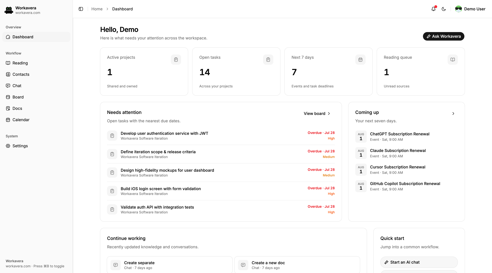
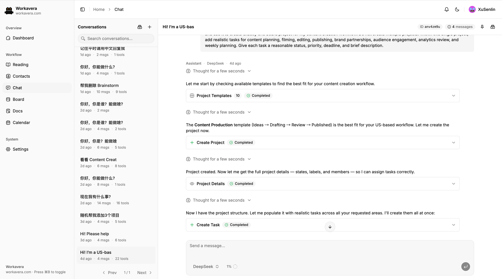
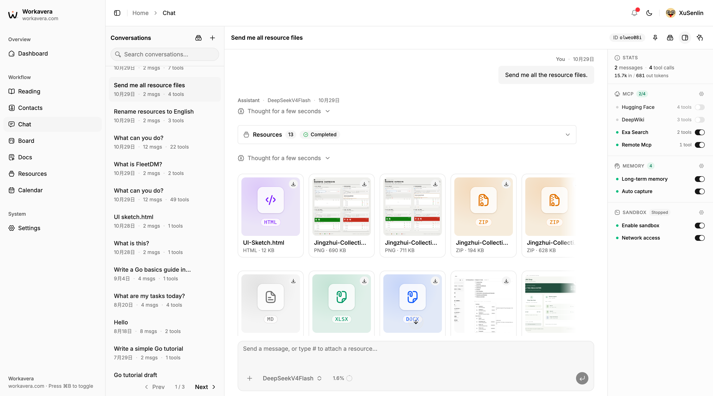
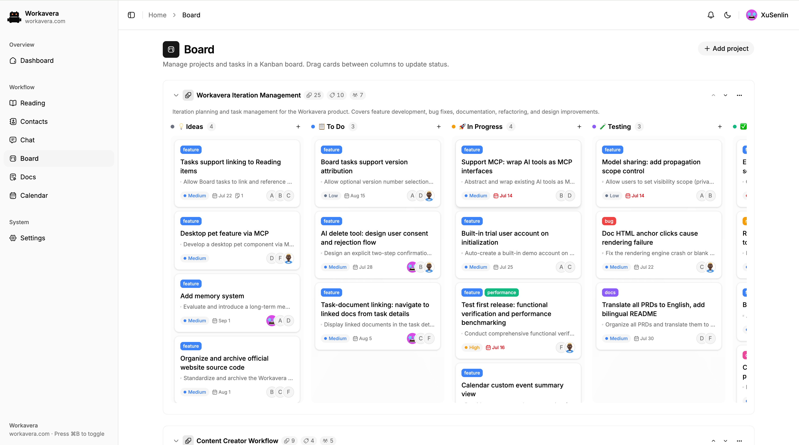
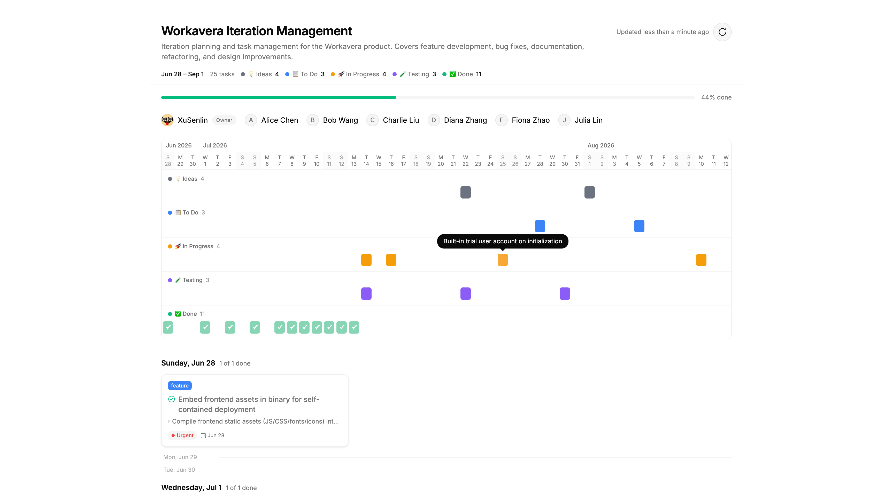
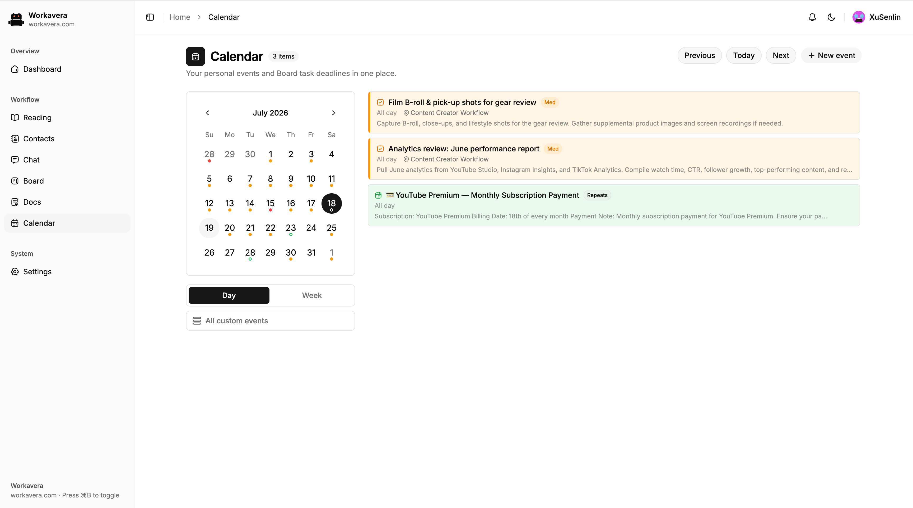
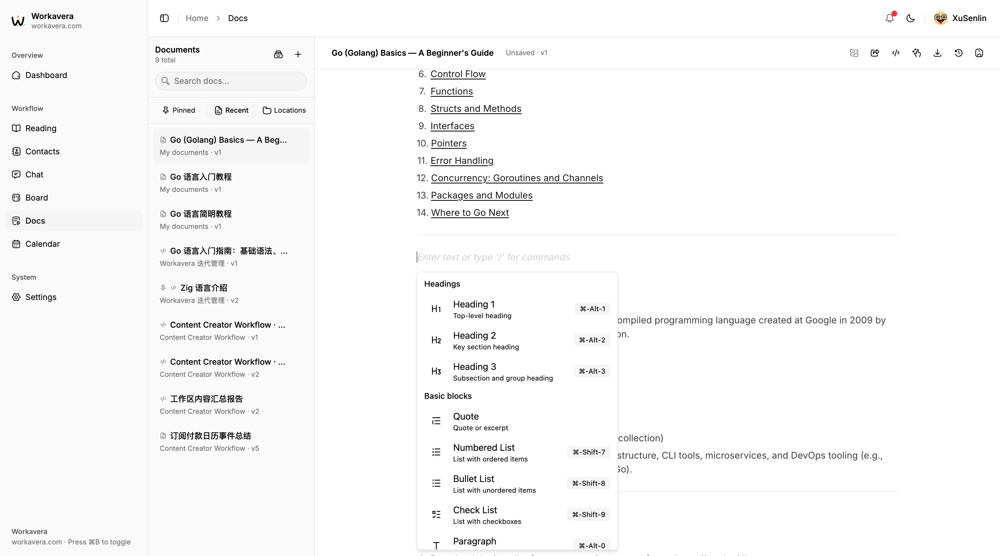
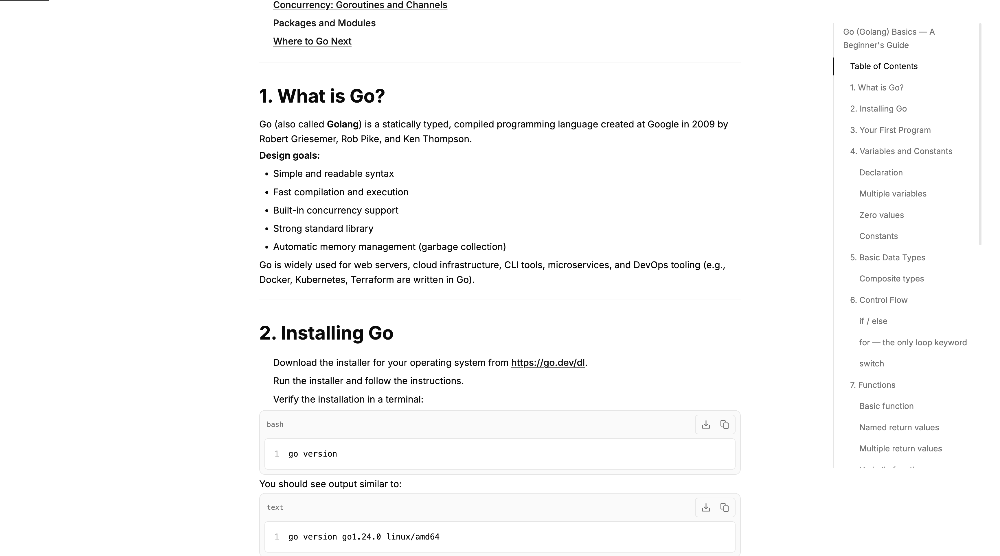
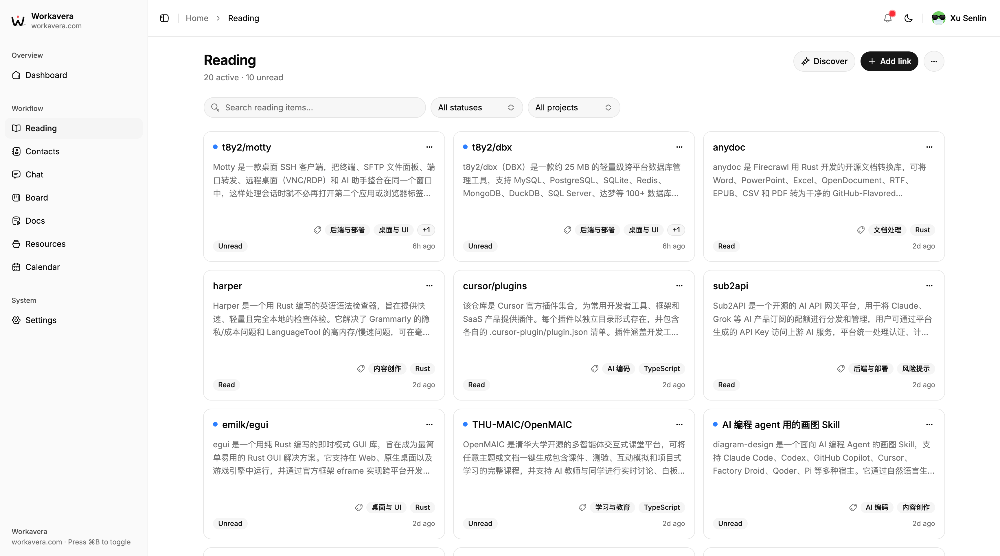
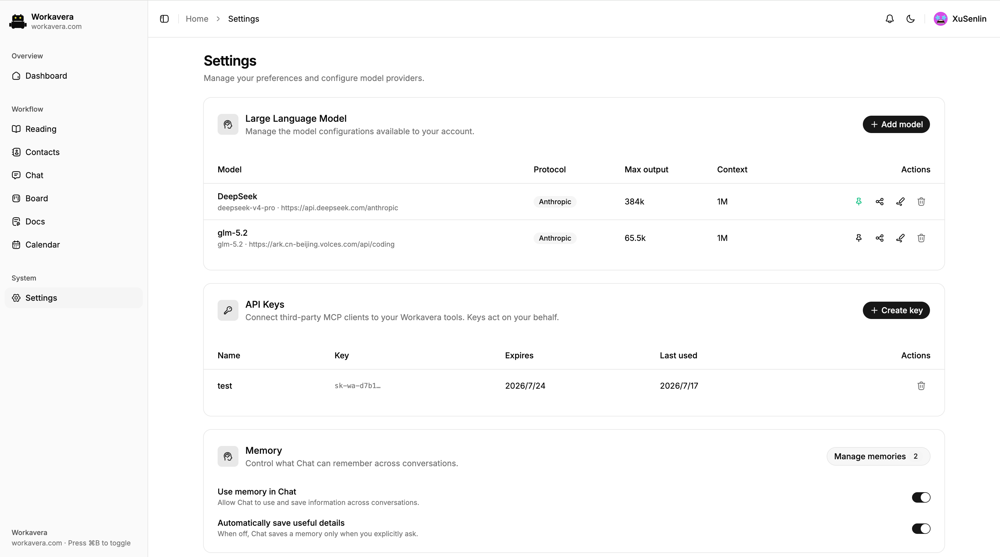

# Workavera

[](./LICENSE)

[简体中文](./README.zh-CN.md)

> **Your projects, docs, calendar, and files in one self-hosted workspace—with an AI assistant that actually gets the work done.**

> 🎉 **New: Sandbox and Resources are here!** Keep your files in **Resources** and attach them to any conversation, then turn on your own **Sandbox** and let the assistant run scripts, process your files, and save the results back to your workspace. See [Resources in Chat](#resources-in-chat) and [Sandbox](#sandbox). 🥳

> ⚠️ **Early-stage software (0.x).** Features are still changing quickly and releases may include breaking changes (see the [changelog](./CHANGELOG.md)). Back up your data before upgrading, and don't rely on it for production work yet.

Workavera is a workspace for freelancers and small teams: plan projects, write documents, keep a calendar, save things to read later, and store your files—all on your own server. Chat ties it together. Ask the assistant to plan a project, pull together what's due this week, answer questions about a PDF, or tidy up your files, and it does the work right in your workspace, with exactly the permissions your account has.

## What you can do

- **Plan projects on Boards.** Kanban boards with your own workflow states, labels, members, and due dates, plus ten ready-made project templates in English and Chinese. Share a read-only timeline with clients through a public link.
- **Write and share Docs.** A rich-text editor with version history, Markdown and HTML export, and AI editing. Publish a document as a public page anyone can read, no account needed.
- **See your schedule in Calendar.** Personal events and Board deadlines in one view, with recurring events and reminders.
- **Get things done in Chat.** The assistant searches your workspace, creates and updates tasks, events, and documents, and shows its reasoning and every step it takes. Conversations keep going after you close the browser, and long-term memory is there if you want it.
- **Keep your files in Resources.** Upload PDFs, Office documents, text, code, images, and archives; search them, filter by type, and attach them in Chat with `+` or `#`. The assistant reads the text inside your documents, so you can ask questions about them.
- **Let the assistant work in a Sandbox.** Turn on a Linux workspace of your own and the assistant can run commands and Python or Node scripts on your files—OCR a scanned PDF, clean up a spreadsheet, batch-rename files—and save the results back to Resources and Docs.
- **Read, discover, and summarize.** Save links and notes to Reading, follow your favorite sources in Discover, and get AI summaries of what's new.
- **Find your team in Contacts.** A searchable team directory with personal favorites.

## Why Workavera

- **An assistant that does the work, not just talks about it.** Most self-hosted AI tools are either a chat window over a model or a notes app with an AI writing helper. In Workavera the assistant operates your workspace—and can never do more than your own account is allowed to.
- **Your data stays with you.** Everything lives on your own server, with no telemetry and no vendor backend. Use the model provider you already pay for, or a model running on your own machine so nothing leaves your hardware.
- **Native mobile apps.** Open-source Android and iOS apps, built natively for phones and tablets, with an Agenda home screen widget—not a web page wrapped in an app. See [Mobile apps](#mobile-apps).
- **Simple to run.** Written in pure Go with no CGO, Workavera ships as one self-contained binary with the web app and database built in. One download or one `docker run`—no runtime to install, no database to set up.
- **Works with the AI tools you already use.** Connect Claude Code, Cursor, and other MCP clients to your workspace with an API key, and bring external MCP tools into Chat.

## Screenshots

### Dashboard



### DeepSeek creating a project and calendar plan



### Resources in Chat



### Board



### Public Board timeline



### Calendar



### Docs editor



### Public document sharing



### Reading and subscription summaries



### Bring your own model



## Get started

Run Workavera with Docker:

```bash
docker run -p 8090:8090 -v workavera-data:/app/pb_data ghcr.io/xusenlin/workavera:latest
```

Or download the binary for your platform from [GitHub Releases](https://github.com/xusenlin/workavera/releases) and run `./workavera serve`.

Then open <http://127.0.0.1:8090>, sign in as `demo@workavera.local` with password `workavera`, change the password in Profile, and add a model in Settings—Chat is ready to go. The [self-hosting guide](./doc/self-hosting.md) covers the admin account, local models, server requirements, and instance settings.

### Sandbox

The sandbox is optional: each user who turns it on in **Settings → Sandbox** gets a Linux workspace of their own, where the assistant runs commands and scripts and moves files to and from Resources and Docs. Its image, with Python, Node.js, pandoc, OCR, and other everyday tools ready to use, is built in [xusenlin/workavera-sandbox](https://github.com/xusenlin/workavera-sandbox). It needs Docker on the server and Workavera running as the downloaded binary rather than the Docker image; see [Sandbox in the self-hosting guide](./doc/self-hosting.md#sandbox) for setup and security notes.

## Mobile apps

Native, open-source Workavera apps for Android and iOS are out. They connect straight to your own server and put Board, Docs, Calendar, Chat, Reading, Contacts, and notifications on your phone and tablet, and an Agenda home screen widget shows your next deadlines and events at a glance.

- **[Download Workavera for Android](https://github.com/xusenlin/workavera-android/releases/latest)**
  from GitHub Releases. Built with Kotlin and Jetpack Compose;
  [source code](https://github.com/xusenlin/workavera-android).
- **[Get Workavera for iOS on the App Store](https://apps.apple.com/app/workavera/id6794339518).**
  A native SwiftUI app for iPhone and iPad;
  [source code](https://github.com/xusenlin/workavera-ios).

### Server compatibility

The apps need a server at least as new as the table below; upgrade the server first, then the apps.

| Android / iOS | Requires server | Because |
| --- | --- | --- |
| 1.0.4 | 0.1.1 or newer | task start dates, public project links, and subscription discovery |
| 1.0.2 | 0.0.10 or newer | task archiving reads `board_tasks.archived` |
| 1.0.1 | 0.0.9 or newer | user-owned MCP servers read `mcp_servers` |

## Documentation and roadmap

The [self-hosting guide](./doc/self-hosting.md) covers installation, first-run setup, privacy and local models, the sandbox, and building from source.

The roadmap below lists each feature with the server version that first shipped it: ✅ done, ⬜ not started yet. A proposal whose product document is marked pending review is open for feedback before work begins; one marked outdated was written against an earlier version and will be revised first.

| | Feature | Version | Product docs |
| --- | --- | --- | --- |
| ✅ | Board | 0.0.1 | [PRD](./doc/v0.0.1-v0.2.x/board-prd.md) · [中文](./doc/v0.0.1-v0.2.x/board-prd.zh-CN.md) |
| ✅ | Calendar | 0.0.1 | [PRD](./doc/v0.0.1-v0.2.x/calendar-prd.md) · [中文](./doc/v0.0.1-v0.2.x/calendar-prd.zh-CN.md) |
| ✅ | Chat | 0.0.1 | [PRD](./doc/v0.0.1-v0.2.x/chat-fantasy-plan.md) · [中文](./doc/v0.0.1-v0.2.x/chat-fantasy-plan.zh-CN.md) |
| ✅ | Docs | 0.0.1 | [PRD](./doc/v0.0.1-v0.2.x/docs-prd.md) · [中文](./doc/v0.0.1-v0.2.x/docs-prd.zh-CN.md) |
| ✅ | Reading | 0.0.1 | [PRD](./doc/v0.0.1-v0.2.x/reading-prd.md) · [中文](./doc/v0.0.1-v0.2.x/reading-prd.zh-CN.md) |
| ✅ | Contacts | 0.0.1 | [PRD](./doc/v0.0.1-v0.2.x/contacts-prd.md) · [中文](./doc/v0.0.1-v0.2.x/contacts-prd.zh-CN.md) |
| ✅ | MCP access for Claude Code, Cursor, and other clients | 0.0.7 | [PRD](./doc/v0.0.1-v0.2.x/mcp-server-prd.md) · [中文](./doc/v0.0.1-v0.2.x/mcp-server-prd.zh-CN.md) |
| ✅ | Chat memory | 0.0.8 | [PRD](./doc/v0.0.1-v0.2.x/chat-memory-prd.md) · [中文](./doc/v0.0.1-v0.2.x/chat-memory-prd.zh-CN.md) |
| ✅ | Connect your own MCP servers to Chat | 0.0.9 | [PRD](./doc/v0.0.1-v0.2.x/mcp-client-prd.md) · [中文](./doc/v0.0.1-v0.2.x/mcp-client-prd.zh-CN.md) |
| ✅ | Public document links | 0.1.0 | [PRD](./doc/v0.0.1-v0.2.x/docs-public-links-prd.md) · [中文](./doc/v0.0.1-v0.2.x/docs-public-links-prd.zh-CN.md) |
| ✅ | Public project timeline | 0.1.1 | [PRD](./doc/v0.0.1-v0.2.x/board-public-preview-prd.md) · [中文](./doc/v0.0.1-v0.2.x/board-public-preview-prd.zh-CN.md) |
| ✅ | Discover subscriptions and AI summaries | 0.1.1 | [PRD](./doc/v0.0.1-v0.2.x/discover-prd.md) · [中文](./doc/v0.0.1-v0.2.x/discover-prd.zh-CN.md) |
| ✅ | Resources | 0.2.0 | [PRD](./doc/v0.0.1-v0.2.x/resources-prd.md) · [中文](./doc/v0.0.1-v0.2.x/resources-prd.zh-CN.md) |
| ✅ | Sandbox | 0.2.0 | [PRD](./doc/v0.0.1-v0.2.x/sandbox-prd.md) · [中文](./doc/v0.0.1-v0.2.x/sandbox-prd.zh-CN.md) |
| ⬜ | Scheduled tasks | Planned | [PRD](./doc/planned/scheduled-tasks-prd.md) · [中文](./doc/planned/scheduled-tasks-prd.zh-CN.md) — pending review, outdated |

## Changelog

Release history is documented in [CHANGELOG.md](./CHANGELOG.md).

## License

Licensed under the [Apache License 2.0](./LICENSE).

Copyright 2026 xusenlin
